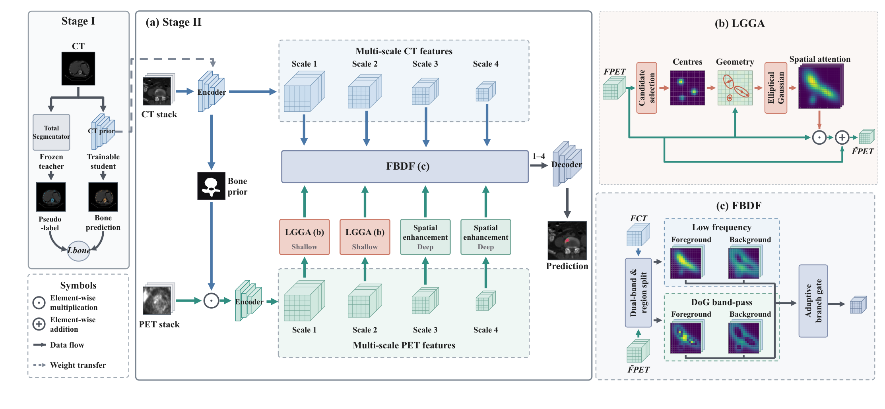
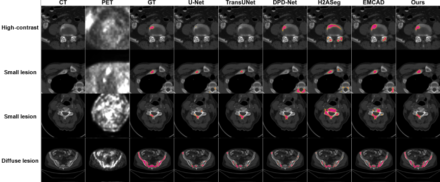
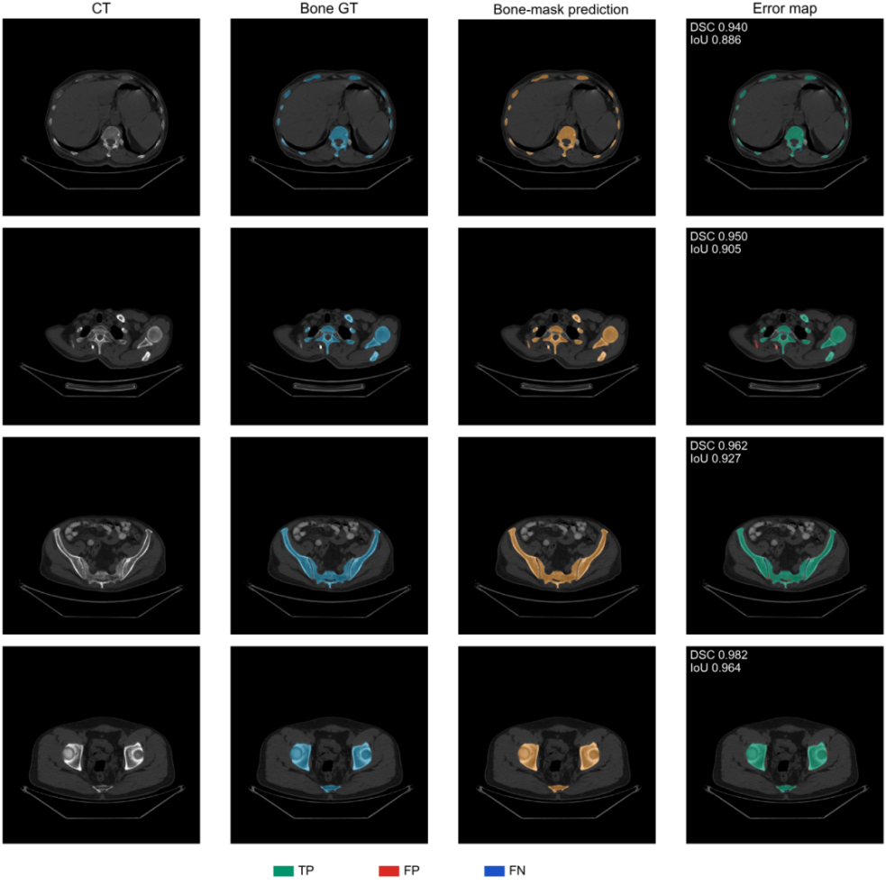

# BonMSeg

## A Bone-Prior-Guided Multimodal Network for Whole-Body PET/CT Bone Metastasis Segmentation

**Xiaolu Xu, Chengjie Lu, Jingyi Zhou, Pinxiao Yu, Yuxing Li, Ying Ding, and Xiaomeng Li**

BonMSeg combines CT-derived bone priors, lesion geometry-aware attention, and foreground-background dual-band fusion for bone metastasis segmentation in whole-body PET/CT images.

[Overview](#overview) | [Installation](#installation) | [Data preparation](#data-preparation) | [Training](#training) | [Results](#results) | [Citation](#citation)

## Overview



*Figure 1 from the accompanying BonMSeg manuscript.*

The framework contains three main components:

- **CT bone prior:** a CT segmentation branch supplies anatomical guidance for bone metastasis segmentation.
- **LGGA:** lesion geometry-aware Gaussian attention enhances PET features according to candidate lesion locations, scales, and orientations.
- **FBDF:** foreground-background aware dual-band fusion combines complementary CT and PET features across low-frequency and Difference-of-Gaussians band-pass components.

The Stage-2 implementation uses a 2.5D stack of neighboring CT and PET slices to predict the lesion mask of the central slice. In the default `student` mode, the internally predicted, dilated bone prior masks the PET representation; the CT branch retains anatomical context. Dataset-provided bone masks are still required for sample filtering and bone-restricted targets.

### Code layout

```text
BonMSeg/
├── assets/
│   └── figures/                         # Framework and qualitative figures
├── datasets/                           # PET/CT loading, normalization, augmentation
│   └── intrabone_petct_dataset.py # Active 2.5D dataset
├── networks/
│   ├── base/                           # Backbone, Stage-1 branch, bone-mask processing
│   │   ├── efficientvim_modules_2d.py
│   │   ├── model_efficientvim_2d_stage1.py
│   │   └── model_stage2_tumor_2d.py
│   └── bonmseg/
│       ├── cross_slice_attention.py
│       ├── fbfa_intrabone_enhanced.py         # Dual-band fusion and shared blocks
│       ├── fbfa_intrabone_enhanced_iddmga.py  # Geometry-aware attention
│       └── model.py  # Full BonMSeg model
├── bone_only_loss_metrics.py
├── comparison_metrics.py
├── train_stage2_2d.py                   # Full BonMSeg training and validation
├── requirements.txt
└── README.md
```

Some source filenames retain the module names `FBFA` and `DGMA` to keep the code traceable. The training entry point imports the complete `FBFAIntraBoneTumorSegmentation` model and defaults to **three input slices**. The directory names do not select the number of slices. Unused single-slice alternatives, module demo entry points, and the inactive encoder-level CSA option have been removed.

## Installation

Use Python 3.11 and install a PyTorch build suitable for your GPU and CUDA environment. The supplied training loop uses CUDA mixed precision with `bfloat16`.

```bash
conda create -n bonmseg python=3.11 -y
conda activate bonmseg
cd BonMSeg
# Install PyTorch and torchvision for your hardware first.
pip install -r requirements.txt
python train_stage2_2d.py --help
```

See the [official PyTorch installation guide](https://pytorch.org/get-started/locally/) for a hardware-specific installation command. Dependency versions in `requirements.txt` reflect the local packaging check environment, rather than a recovered lock file from the original experiments. Full training has not been repeated with this reorganized release.

## Data preparation

Prepare registered CT/PET axial slices and matching binary masks at **512 x 512** resolution. The loader accepts the following flat directory structure:

```text
data/img1/
├── train_tumor.txt
├── val_tumor.txt
├── subject001_000_CT.png
├── subject001_000_PET.png
├── subject001_000_mask.png
├── subject001_000_bone_pred.png
├── subject001_001_CT.png
├── subject001_001_PET.png
├── subject001_001_mask.png
└── subject001_001_bone_pred.png
```

| File | Content |
| --- | --- |
| `*_CT.png` | CT slice; `--is_16bit true` expects unsigned 16-bit values encoded with a +1024 HU offset |
| `*_PET.png` | Spatially registered PET slice |
| `*_mask.png` | Binary lesion annotation, encoded as 0 and 255 |
| `*_bone_pred.png` | Binary reference bone prior, encoded as 0 and 255 |
| `train_tumor.txt`, `val_tumor.txt` | One slice identifier per line, without the file suffix |

For example:

```text
subject001_000
subject001_001
subject001_002
```

Despite their names, the split lists should include both lesion-containing and lesion-free slices needed for neighboring-slice lookup and negative sampling. Keep all slices from a patient in the same split. Slice identifiers must end with an underscore and an integer slice index; missing neighbors are replaced with the central slice.

CT normalization uses a bone window with center 400 HU and width 1200 HU. PET normalization uses the 5th and 99.5th percentiles followed by a gamma transform. The loader does not perform registration or a general NIfTI/DICOM-to-PNG conversion.

The manuscript reports 160 patients split into training/validation/test sets of 112/24/24 patients (27,591/6,045/5,782 slices). Patient data, split lists, and pretrained weights are not included in this code snapshot.

## Training

Place a compatible pretrained Stage-1 checkpoint at `checkpoints/stage1/best_model.pth`, or supply its path with `--stage1_model_path`. Stage-1 training and pseudo-label generation scripts are not included in this snapshot.

Run the following from the repository root. The 150-epoch budget follows the manuscript and the current training defaults.

```bash
python train_stage2_2d.py --data_root data/img1 --stage1_model_path checkpoints/stage1/best_model.pth --save_dir checkpoints --exp_name bonmseg --stage2_bone_prior_source student --n_slices 3 --epochs 150 --batch_size 4 --accumulation_steps 4 --ct_lr 2e-7 --main_lr 4e-6 --iddmga_lr 4e-6
```

| Option | Default | Meaning |
| --- | --- | --- |
| `--n_slices` | `3` | Number of neighboring axial slices per modality |
| `--stage2_bone_prior_source` | `student` | Internal predicted prior; `teacher` uses dataset-provided bone masks |
| `--freeze_stage1` | `false` | Whether to freeze the CT bone branch |
| `--bone_dilation` | `5` | Dilation kernel for the predicted bone prior |
| `--batch_size` | `4` | Mini-batch size |
| `--accumulation_steps` | `4` | Gradient accumulation steps |
| `--epochs` | `150` | Maximum training epochs |
| `--min_tumor_pixels` | `100` | Minimum bone-restricted lesion area used for positive-slice filtering |
| `--seed` | `42` | Random seed |

Training creates `checkpoints/bonmseg_<timestamp>/` containing `training.log`, TensorBoard events, and `best_model.pth` when the validation selection criteria are met. The checkpoint stores the selected threshold, training arguments, model parameters, and optimizer/scheduler states. The supplied script does not export a final checkpoint at every epoch.

To resume from a saved checkpoint, add `--resume_from path/to/best_model.pth` to the training command. Use `python train_stage2_2d.py --help` for all options.

```bash
tensorboard --logdir checkpoints
```

### Validation and inference

Validation runs during training and evaluates multiple probability thresholds. Bone-restricted overlap metrics and patient-level HD95/ASSD are computed from cached prediction masks. Surface distances use unit grid spacing, so they are expressed in **pixels/grid units**, not millimeters.

A standalone test/inference script, test split, and trained model weights are not included in this snapshot. The manuscript results below are reported reference results; this release does not yet provide all assets needed to reproduce the full experimental pipeline.

## Results

### Quantitative comparison

Results transcribed from **Table 1, page 12 of the supplied `BonMSeg.pdf`**. Higher DSC/IoU and lower HD95 indicate better performance. HD95 is reported in pixels. These values were not recomputed during repository organization.

| Method | DSC ↑ | IoU ↑ | HD95 ↓ |
| --- | ---: | ---: | ---: |
| U-Net | 0.5376 | 0.3825 | 35.9375 |
| H2ASeg | 0.4867 | 0.3401 | 38.5231 |
| AAHN | 0.6164 | 0.4598 | 32.4745 |
| DpDNet | 0.6306 | 0.4715 | **20.2630** |
| TransUNet | 0.6311 | 0.4751 | 29.8650 |
| EMCAD | 0.6145 | 0.4605 | 34.2058 |
| **BonMSeg** | **0.6562** | **0.4994** | 28.6209 |

### Qualitative comparison



*Figure 2 from the manuscript: CT, PET, ground truth, and predictions from representative segmentation methods.*

### CT bone prior



*Figure 3 from the manuscript: CT, reference bone masks, predicted bone masks, and error maps.*

The figures come from Figures 1-3 of the supplied BonMSeg manuscript.

## Citation

If you use BonMSeg in your research, please cite **BonMSeg: A Bone-Prior-Guided Multimodal Network for Whole-Body PET/CT Bone Metastasis Segmentation**. A publication link and BibTeX entry will be added when the final bibliographic metadata is available.

## Acknowledgements

The manuscript uses [TotalSegmentator](https://github.com/wasserth/TotalSegmentator) to generate CT bone pseudo-labels. We acknowledge the related backbone and segmentation research underlying this implementation. README organization follows common medical segmentation repositories, including [TransUNet](https://github.com/Beckschen/TransUNet), [MedSAM](https://github.com/bowang-lab/MedSAM), and [nnU-Net](https://github.com/MIC-DKFZ/nnUNet).

## License and contact

A repository license has not yet been specified. License terms and third-party attribution should be finalized before public distribution. For questions about the code, please open a GitHub issue in this repository.
